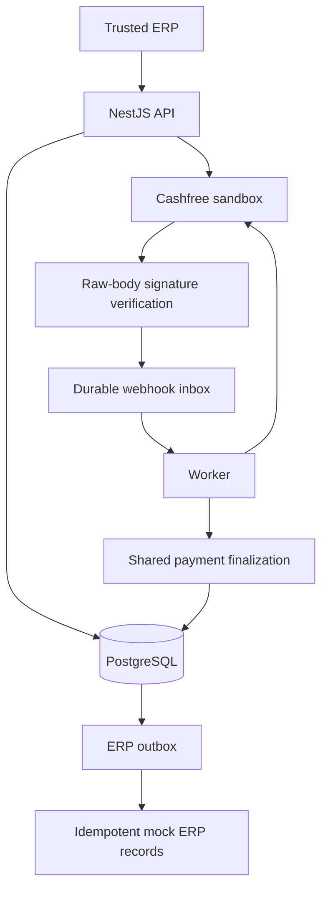
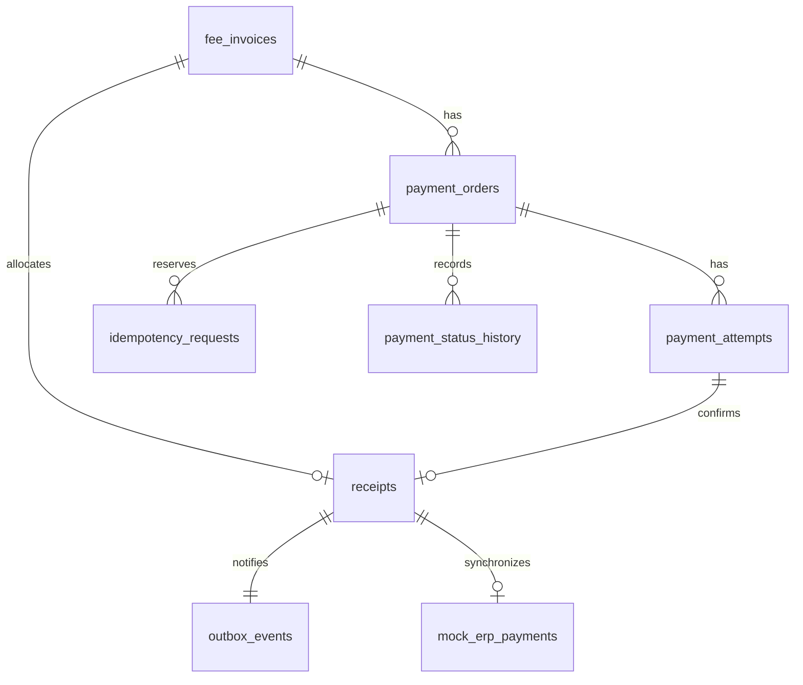

# Architecture, database, and operations



## Files

- `src/http`: authenticated routes, DTOs, raw webhook endpoint, health and Swagger.
- `frontend/src`: React payment console, authenticated API client, Cashfree hosted checkout, receipts, and operations view.
- `frontend/dist`: compiled production frontend served by NestJS; generated by `npm run build:web`.
- `src/payments/payments.service.ts`: order reservations, invoice rules, recovery, shared transactional finalization.
- `src/cashfree/cashfree.client.ts`: sandbox REST boundary, exact money conversion, signature verification.
- `src/webhooks`: durable inbox ingestion.
- `src/jobs`: webhook processing, gateway reconciliation, ERP outbox delivery.
- `src/database`: connection/transactions, migration runner, repeatable demo seed.
- `migrations`: versioned SQL schema.
- `test`: unit/HTTP/lifecycle emulator tests and optional actual PostgreSQL tests.

## Data model



`webhook_events` is an independent inbox, deliberately able to store unknown-order events. `payment_exceptions` records mismatches, unknown orders, or additional successful payments for investigation. `receipts.invoice_id UNIQUE` models one full allocation per invoice; add an allocations ledger if implementing partial payments later.

## Initiation

The API locks the invoice, reserves a local order and request key, commits, then calls the gateway. A partial unique index permits at most one active order per invoice. Calls with different keys reuse that active order. The API key table is global because this implementation supports a single trusted ERP; scope it before adding tenants.

Each local order gets a persistent UUID gateway idempotency key, separate from the caller's key. A timeout does not imply failure. Lookup by the same merchant order ID precedes creation, and retries use the same gateway key. Concurrent requests may both contact Cashfree, but both target the same merchant ID and idempotency key. HTTP calls never run inside a database transaction. Explicitly expired/terminated orders release the active constraint. New payments are not initiated for paid invoices.

Gateway order creation may race a webhook; the resulting update preserves already-paid local state. A gateway `PAID` order alone is not used to issue a receipt: a matching successful attempt is required.

## Confirmation

Signed webhooks and authenticated gateway lookups feed the same finalizer. It locks invoice then order, validates payment/order relationships, currency and amount, records the attempt, and applies success without downgrading it. Failure, pending, cancelled and abandoned attempts leave the invoice payable. Unknown states are retained but cannot fulfill an invoice.

Receipt creation, paid invoice state and outbox insertion commit atomically. Repeated success causes no additional receipt. Other local orders become `SUPERSEDED`, remain under reconciliation, and cannot be returned as fresh checkout sessions. This does not cancel an already-open gateway checkout; a different successful attempt after an invoice is paid remains in the records and raises `ADDITIONAL_SUCCESS_REQUIRES_REVIEW`. An operator should resolve that excess payment; the module never silently discards it or automatically refunds it.

## Webhook security and delivery

Signature: Base64 HMAC-SHA256 of timestamp concatenated directly with the exact raw body, using the Cashfree test secret. Nest's `rawBody: true` preserves bytes. Comparison is constant time for equal-length signatures. Store verified payload before returning 200; a database failure returns an error so delivery can retry. Duplicate detection hashes signed raw bytes. Different deliveries for the same `cf_payment_id` still update its state, including pending-to-success.

There is deliberately no arbitrary short timestamp rejection window: legitimate delayed/replayed provider delivery must not be discarded without confirming provider retry semantics. Signed replay is harmless for financial fulfillment because of durable deduplication and unique receipt constraints. Unsupported signed event types are acknowledged and marked processed without financial action. Malformed supported events retry and eventually become `DEAD`; unknown-order events are quarantined as exceptions. Alerts should monitor these tables in a real deployment.

## Worker and recovery

A session advisory lock permits one worker tick at a time. It remains on a dedicated database connection and is released on crash. Work is not irreversibly claimed: a crash after financial commit but before marking inbox `DONE` causes a safe replay. ERP delivery similarly uses receipt ID as its idempotency identity. Exponential retry is capped at one hour; after ten failures the event is `DEAD`.

Reconciliation polls up to 20 due orders per tick, no more than once per minute per order, with oldest checks first. Active orders and confirmed expired/terminated orders are rechecked to detect delayed success. Expired order retention/reconciliation horizons are intentionally left configurable in a production deployment; this small assessment continues checking them. An unconfigured gateway does not block webhook processing or ERP delivery.

## Operational SQL

Run through pgAdmin/psql using an authorized database account:

```sql
SELECT state, count(*) FROM webhook_events GROUP BY state;
SELECT state, count(*) FROM outbox_events GROUP BY state;
SELECT * FROM payment_exceptions ORDER BY created_at DESC;
SELECT * FROM mock_erp_payments ORDER BY received_at DESC;

-- Replace the UUID after fixing a failed delivery's underlying problem.
UPDATE outbox_events SET state='PENDING', attempts=0, next_run_at=now(), last_error=NULL
WHERE id='REPLACE-WITH-EVENT-UUID' AND state='DEAD';

UPDATE webhook_events SET state='PENDING', attempts=0, next_run_at=now(), last_error=NULL
WHERE id='REPLACE-WITH-EVENT-UUID' AND state='DEAD';
```

No PAN/CVV/card credentials are stored. Database phone numbers and raw signed event payloads are personal data: restrict access, encrypt storage using deployment facilities, and define retention. No public endpoint permits directly setting a payment to successful.
